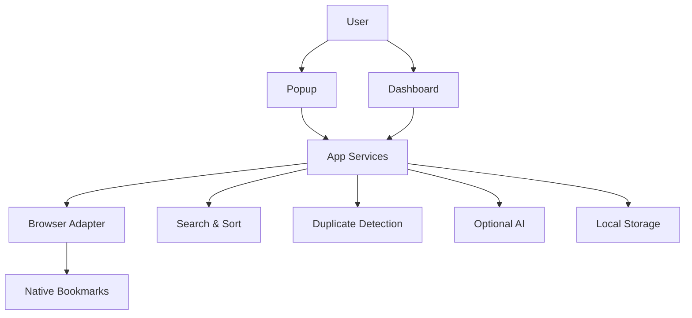
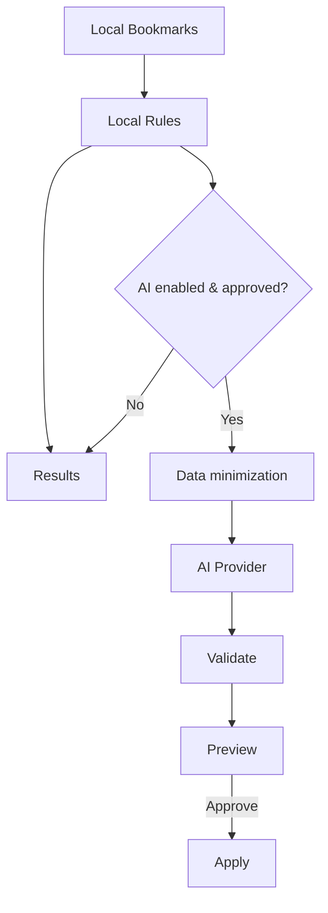

# Architecture

## Overview

BS-EXT is a Manifest V3 browser extension with a service worker, popup, options page, and full-page dashboard. Browser bookmarks are the source of truth; extension metadata stored in chrome.storage.local.

## Mermaid

## Data flow / privacy

